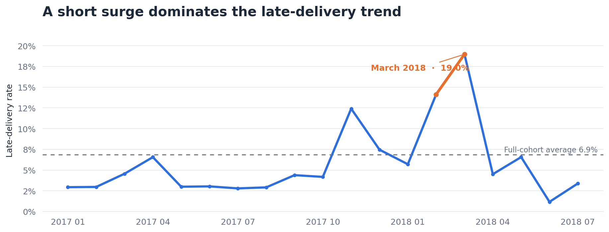
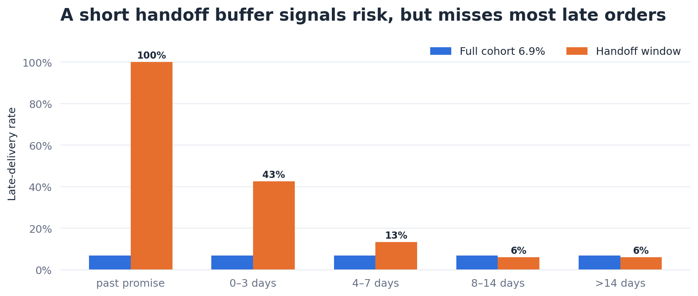
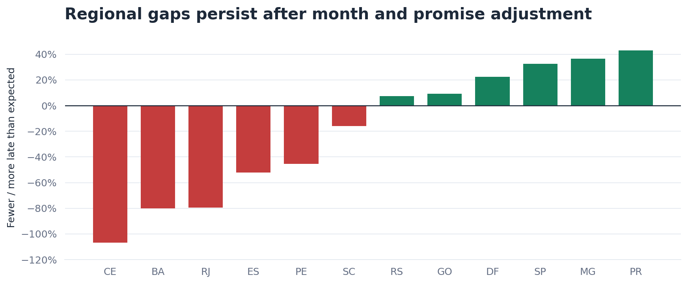
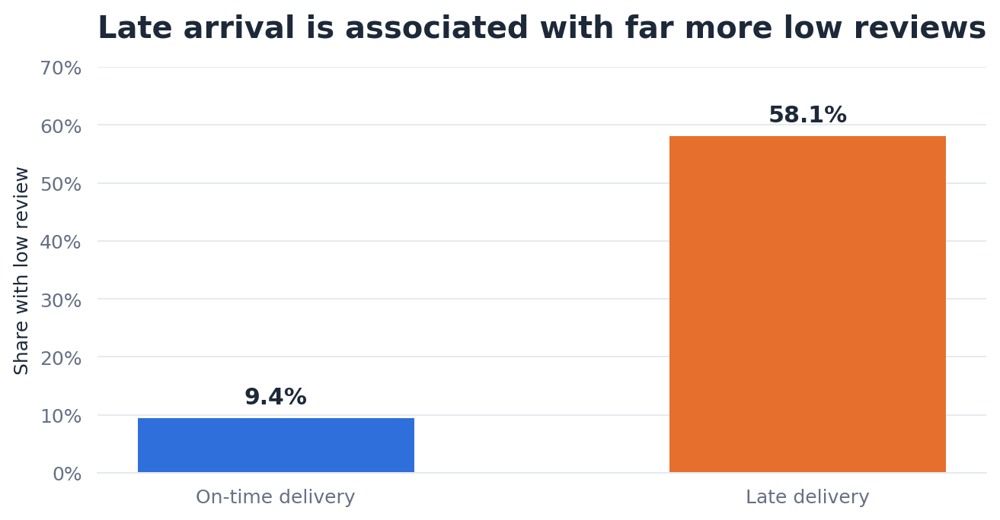

# The promise clock: Olist delivery intelligence

An evidence-backed supply chain case study built from historical Brazilian ecommerce orders. Open the [interactive report](report.html) for the full argument or the [dashboard](dashboard.html) for the key views. Both HTML files work offline.

## Problem statement

An on-time delivery rate alone cannot tell a fulfillment team whether missed promises arise before carrier handoff, in transit, from promise design, or from a temporary shock. A useful analysis must show **when the promise became endangered**, how much risk an operational alert could catch, and which gaps survive basic differences in order mix. This project uses **time left on the customer promise at carrier handoff** as its central diagnostic clock.

The decision is where to investigate and pilot improvements first. These data do not identify a carrier, route event, cost, or causal effect. The clock is a distinctive frame for this project; no claim of global novelty is made.

## What the evidence says

| Question | Finding | Decision implication |
| --- | --- | --- |
| How large is the problem? | **6,503 of 94,702** eligible delivered orders arrived after the promised calendar date (**6.87%**). | Keep the denominator explicit; unresolved orders are a separate problem. |
| Was risk steady? | February–March 2018 purchases produced **2,254 late orders**, **34.7%** of all late orders from **14.3%** of deliveries. | Investigate the surge as a historical incident before generalizing a permanent fix. |
| Was the promise already missed at handoff? | Only **322 of 6,500** late orders with valid stage dates were already past the promise at handoff. **69.4%** still had more than 14 days left. | Examine transit and lane events as well as seller handoff. |
| Would a short-buffer alert solve most misses? | At **three or fewer days left**, 1,162 orders are flagged; 680 were late (**58.5% precision**) but they are only **10.5%** of stage-eligible late orders. | Use it for a focused intervention, not the whole recovery strategy. |
| Do location gaps remain after mix adjustment? | Rio de Janeiro and Bahia each had about **1.8 times** the late deliveries expected from purchase-month and promise-length mix. | Prioritize comparable lane investigations; do not infer cause from state alone. |
| Do customers notice? | Low-review rates were **58.1% for late** versus **9.4% for on-time** among comparable reviewed orders after state and month standardization. | Measure customer outcomes in a pilot; this is an association. |

## The graphs

Orange marks late delivery risk, blue marks the cohort or on-time comparison, and red/green mark above/below expected state risk. Values and labels carry the meaning without color alone.



The surge is visible by **purchase month**. Partial August 2018 is excluded from this trend.



Handoff slack identifies a small high-risk group, while the majority of late orders had a much longer buffer.



State ratios use pooled rates within purchase-month and promise-length cells; this is descriptive adjustment.



Low review means a mean order review score of 1 or 2. The comparison is standardized over comparable state and month strata.

## Data and method

Source: [Brazilian E-Commerce Public Dataset by Olist](https://www.kaggle.com/olistbr/brazilian-ecommerce/home/). This analysis is **not a live view of Olist**. The purchase cohort begins January 1, 2017 and ends August 18, 2018, 60 days before the last observed delivery. The headline rate includes only delivered orders with actual and estimated delivery dates. Other statuses are counted separately, not treated as on time.

The unit is one order. Items and reviews are aggregated before joining. Delivery is late when the **actual delivery calendar date** is later than the **estimated delivery calendar date**. Stage analyses require valid, ordered carrier and delivery timestamps. The state comparison is observed late orders divided by expected late orders using pooled late rates in purchase-month × promise-length cells, for states with at least 1,000 eligible deliveries. See [methods and hard questions](docs/METHODS.md) for definitions, caveats, and the proposed pilot.

## Reproduce the analysis

The raw Olist CSVs are intentionally not committed. Download them from the [dataset page](https://www.kaggle.com/olistbr/brazilian-ecommerce/home/) and place `olist_orders_dataset.csv`, `olist_order_items_dataset.csv`, `olist_customers_dataset.csv`, `olist_order_reviews_dataset.csv`, and `olist_products_dataset.csv` in `data/raw/`.

From the repository root, with Python 3.10 or newer:

```powershell
python -m pip install -r requirements.txt
python analyze.py
python validate.py
python build_report.py
python build_dashboard.py
python make_figures.py
```

`analyze.py` rebuilds aggregate CSVs and a local order-level table. `validate.py` independently checks headline counts with DuckDB. The report builders refresh the canonical JSON manifests; `make_figures.py` exports the four README graphs. The committed HTML files were exported from those manifests with the Data Analytics portable artifact reader and can be opened directly. That reader is an external build dependency for **re-exporting HTML** after changing a manifest; the Python analysis and PNG graphs rebuild from the listed requirements.

## Repository map

| Path | Purpose |
| --- | --- |
| [`report.html`](report.html) · [`dashboard.html`](dashboard.html) | Portable interactive deliverables |
| [`assets/`](assets/) | Four publication-ready PNG graphs |
| [`outputs/`](outputs/) | Reviewed aggregate CSVs and findings JSON |
| [`artifact.json`](artifact.json) · [`dashboard-artifact.json`](dashboard-artifact.json) | Source-backed portable manifests |
| [`analyze.py`](analyze.py) · [`validate.py`](validate.py) | Analysis and independent reconciliation |
| [`build_report.py`](build_report.py) · [`build_dashboard.py`](build_dashboard.py) · [`make_figures.py`](make_figures.py) | Artifact and graph builders |
| [`docs/METHODS.md`](docs/METHODS.md) | Metric definitions, unanswered questions, and pilot design |

## Limits and licensing

The public tables lack carrier identity, hub scans, delivery attempts, inventory positions, carrier invoices, refunds, and contribution margin. Freight value is a customer charge, not a delivery cost. No cost-saving or causal claim is possible from this extract. See [data attribution and terms](DATA_LICENSE.md): Olist data and adaptations are subject to CC BY-NC-SA 4.0. The Python source has a separate [MIT code license](LICENSE-CODE).
