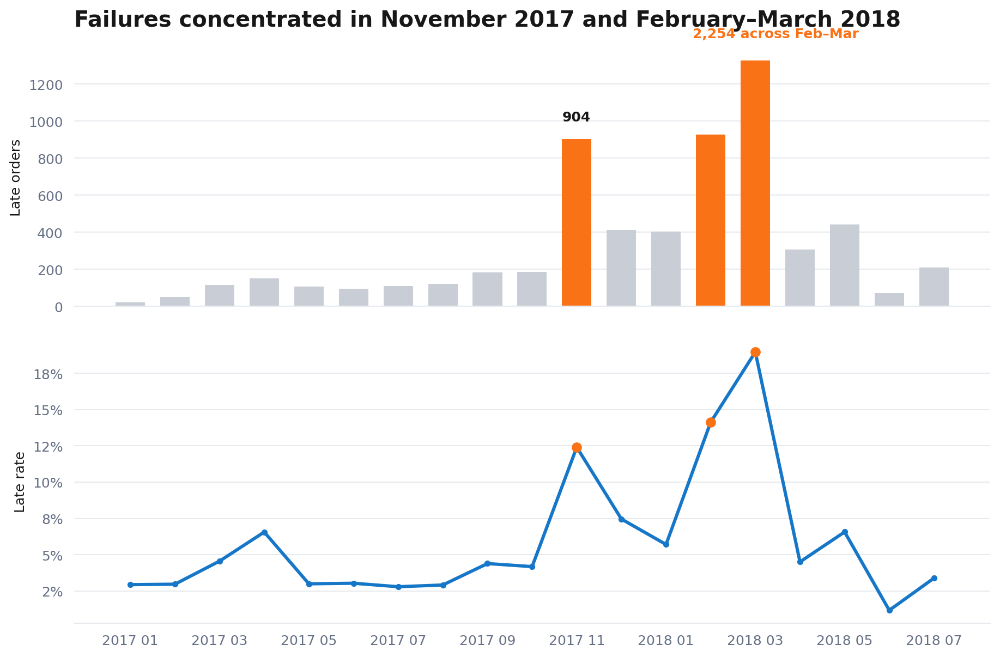
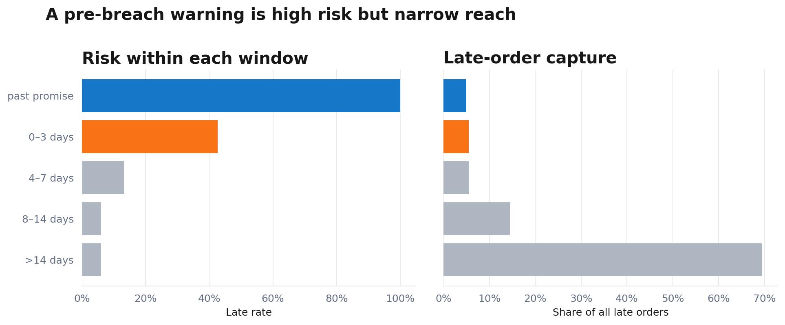
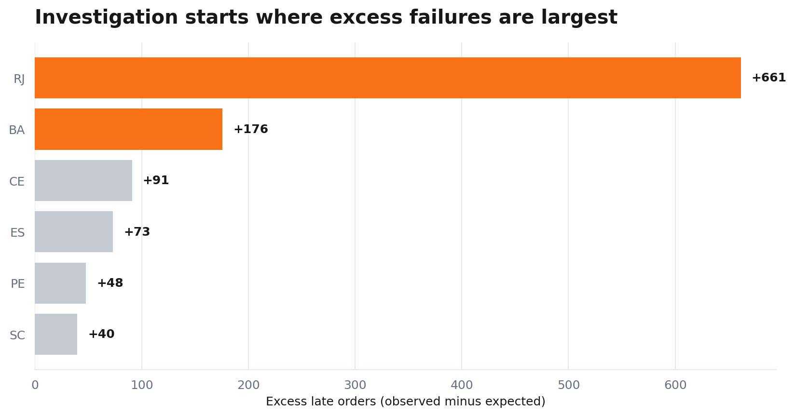
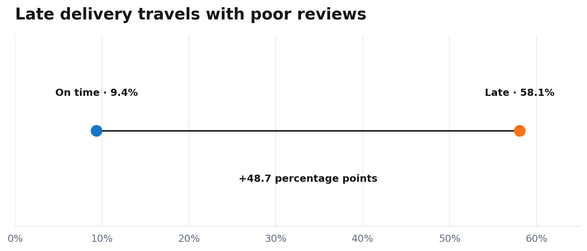

# Olist Delivery Intelligence

[](https://www.python.org/)
[](https://duckdb.org/)
[](report.html)
[](LICENSE-CODE)

An evidence-backed shareholder story about delivery reliability in the historical Olist Brazilian ecommerce dataset. The analysis identifies where failures concentrated, when intervention remained possible, and which actions should be tested next.

> **Historical public-data case study.** The findings do not describe current Olist performance.

**[Read the shareholder story](report.html)** · **[Open the historical diagnostic](dashboard.html)** · **[Review the methodology](docs/METHODS.md)**

## Executive finding

| Eligible deliveries | Late deliveries | Late-delivery rate |
| ---: | ---: | ---: |
| **94,702** | **6,503** | **6.9%** |

Roughly **one in fifteen** eligible deliveries arrived after the promised date. February–March 2018 generated **34.7% of late deliveries from only 14.3% of eligible volume**.

## The shareholder story

| Question | Evidence-backed answer |
| --- | --- |
| **How large is the problem?** | **6,503 of 94,702** eligible completed deliveries were late: **6.87%**. |
| **When did failures concentrate?** | February–March 2018 produced **34.7% of late deliveries from 14.3% of volume**. November 2017 was another visible incident. |
| **When was intervention possible?** | A true **0–3 day pre-breach warning** flagged 840 orders. It was **42.6% precise**, but captured only **5.5%** of stage-eligible late orders. |
| **Where should investigation begin?** | Rio de Janeiro had approximately **661 excess late deliveries** after basic adjustment; Bahia followed with approximately **176**. |
| **Can promise policy conceal slow service?** | Orders promised beyond 30 days had a **5.0% late rate**, yet still took a median **15 days** to arrive. |
| **Why does this matter?** | In comparable groups, low-review rates were **58.1% for late** versus **9.4% for on-time** deliveries—a **48.7-point gap**. |
| **What should be tested?** | A randomized pre-breach warning, an RJ/BA route pilot, and a promise-and-communication experiment. |

## Visual evidence

### Failures concentrated in November 2017 and February–March 2018

Late-order volume and late rate rise together during the principal incidents. March 2018 reached a **19.0% late rate**.



### The actionable warning window has high risk but narrow reach

Orders handed off with **0–3 days remaining** were late 42.6% of the time, but represented only 5.5% of stage-eligible late orders. Already-breached orders remain a separate escalation population.



### Investigation should start with absolute excess failures

Rio de Janeiro and Bahia combine elevated adjusted risk with the largest operational burden. Ceará has higher relative risk than its absolute excess count suggests.



### Late delivery is strongly associated with poor reviews

After restricting comparison to common state-by-month support, **58.1% of late deliveries received low reviews versus 9.4% of on-time deliveries**. This is an association, not proof of causation.



## What to test next

1. **Pre-breach warning:** randomize the 0–3 day alert and measure incremental on-time delivery, not alert precision alone.
2. **RJ/BA route pilot:** target high-burden lanes and compare late orders per 1,000 eligible deliveries against a holdout.
3. **Promise and communication test:** compare clearer promises and proactive updates using actual delivery time, late rate, and review outcomes.

These are controlled tests, not proven interventions. The public dataset contains no treatment, carrier-cost, refund, or contribution-margin data.

## Analytical safeguards

- The fixed purchase window runs from **January 1, 2017 through August 18, 2018**.
- The headline population contains completed deliveries with actual and promised timestamps. Other statuses remain separate.
- “Late” means the actual delivery calendar date is after the promised calendar date.
- Already-breached orders are separated from the actionable 0–3 day warning population.
- Seller deadline comparisons use exact timestamps, including same-day late handoffs.
- State estimates adjust for purchase month and promised-delivery window; order-level bootstrap intervals show uncertainty.
- Review standardization retains **68,416 orders**, or **72.7% of reviewed orders**, across comparable state × month strata.
- The analysis makes no causal, financial-return, or current-performance claim.

See [METHODS.md](docs/METHODS.md) for metric definitions, observation rules, uncertainty, sensitivity checks, and validation coverage.

## Reproduce the analysis

The recorded data snapshot is checked against [`data/source_manifest.json`](data/source_manifest.json) before analysis.

```powershell
python -m pip install -r requirements.txt
python analyze.py
python validate.py
python build_report.py
python build_dashboard.py
python make_figures.py
```

| Component | Responsibility |
| --- | --- |
| [`analyze.py`](analyze.py) | Builds corrected order-level aggregates, intervals, findings, and build metadata. |
| [`validate.py`](validate.py) | Independently recomputes headline, intervention, seller, review, and output reconciliations. |
| [`build_report.py`](build_report.py) | Creates the primary scrolling story with inline SVG, accessible tooltips, evidence tables, and offline fallbacks. |
| [`build_dashboard.py`](build_dashboard.py) | Creates the compact historical diagnostic. |
| [`make_figures.py`](make_figures.py) | Regenerates the four README figures from validated outputs. |

## Repository map

| Path | Purpose |
| --- | --- |
| [`report.html`](report.html) | Primary seven-question shareholder story |
| [`dashboard.html`](dashboard.html) | Secondary historical diagnostic |
| [`outputs/`](outputs/) | Corrected aggregates, findings, intervals, and build metadata |
| [`assets/`](assets/) | Static chart fallbacks and README figures |
| [`docs/METHODS.md`](docs/METHODS.md) | Definitions, uncertainty, sensitivity, and test design |

## Data source and licensing

Data source: [Brazilian E-Commerce Public Dataset by Olist](https://www.kaggle.com/olistbr/brazilian-ecommerce/home/). Dataset use and adaptations follow [DATA_LICENSE.md](DATA_LICENSE.md). Repository code is released under the [MIT License](LICENSE-CODE).

**Keywords:** Olist · delivery analytics · ecommerce analytics · logistics intelligence · late-delivery prediction · customer experience · review analysis · data storytelling · shareholder reporting · Python · DuckDB · reproducible analytics
